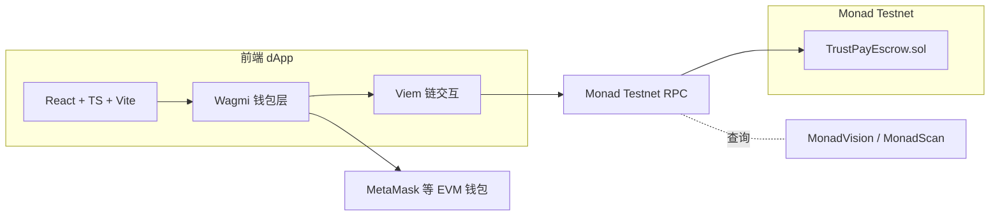
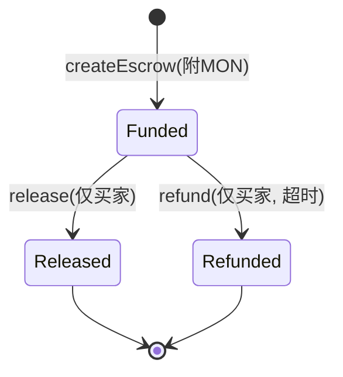

# TrustPay Lite — 系统架构设计（ARCHITECTURE）

> 版本：v1.0　|　更新：2026-11-16

## 1. 系统架构总览



**无自建后端**：前端直接通过 RPC 与链上合约交互，钱包负责签名。数据唯一可信源是链。

## 2. 技术选型及理由

| 模块 | 选型 | 理由 |
|---|---|---|
| 智能合约 | Solidity 0.8.31 | 官方模板锁定版本，EVM 目标 `osaka` |
| 合约开发环境 | Hardhat 3 | 官方推荐；本地已可用 npx 拉取 3.22.0 |
| 安全组件 | OpenZeppelin | 使用 `ReentrancyGuard` 等成熟防重入实现 |
| 前端 | React + TypeScript + Vite | 类型安全、启动快、生态成熟 |
| 钱包交互 | Wagmi + Viem | 官方模板同款；Wagmi 封装钱包连接，Viem 负责底层调用 |
| 网络 | Monad Testnet | Chain ID 10143，RPC `https://testnet-rpc.monad.xyz`，原生 MON |
| 版本管理 | Git + GitHub | 待你确认后再上传 |

> 调整记录：因本环境 `git clone` GitHub 受限，Phase 2 改为 `npm` 手动搭建 Hardhat 3 项目（功能等价，仅跳过 clone 模板步骤）。

## 3. 智能合约设计

### 3.1 状态机



### 3.2 安全设计要点

1. **Checks-Effects-Interactions（CEI）**：先校验（Checks）→ 再改状态（Effects）→ 最后转账（Interactions），防止重入。
2. **重入防护**：继承 `ReentrancyGuard`，`release`/`refund` 加 `nonReentrant`。
3. **零地址校验**：`createEscrow` 拒绝 `seller == address(0)`。
4. **金额校验**：拒绝 `msg.value == 0`。
5. **权限校验**：`release`/`refund` 用 `require(msg.sender == escrow.buyer)`。
6. **状态校验**：仅 `Funded` 状态可 release/refund，防止重复释放/退款。
7. **时间校验**：`refund` 要求 `block.timestamp >= deadline`。
8. **余额一致性**：每笔托管金额独立记账，转账用 `call` 并检查返回值。

## 4. 项目目录结构

```
trustpay-lite/
├── contracts/            # 智能合约
│   └── TrustPayEscrow.sol
├── test/                 # 合约测试
│   └── TrustPayEscrow.test.ts
├── ignition/             # 部署模块
│   └── modules/TrustPayEscrow.ts
├── frontend/             # React 前端
│   ├── src/
│   │   ├── App.tsx
│   │   ├── components/
│   │   ├── hooks/
│   │   ├── config/       # 合约地址与 ABI
│   │   └── pages/
│   ├── index.html
│   ├── vite.config.ts
│   └── package.json
├── hardhat.config.ts
├── package.json
├── .env.example
├── .gitignore
└── docs/                 # 交付文档
```

## 5. 关键风险与对策

| 风险 | 影响 | 对策 |
|---|---|---|
| GitHub 直连受限 | 无法 clone 模板 | npm 手动搭建（已确认 registry 可用） |
| Monad 配置变更 | 部署失败 | 每次部署前重新核实 RPC/ChainID |
| 私钥泄露 | 资金损失 | keystore/环境变量，不入库不入对话 |
| 前端状态与链上不一致 | 误导用户 | 以链上事件为准，读合约状态刷新 |

## 6. 架构自检结论

- 业务规则无矛盾：release 与 refund 通过「状态 + 时间 + 调用者」三重条件保证互斥。
- 权限全部收敛到合约侧，前端仅做展示与引导，不做安全判断。
- 数据唯一可信源为链上合约，无中心化后端单点。
