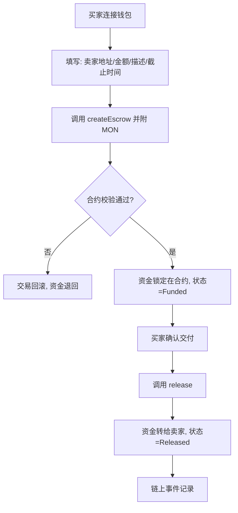
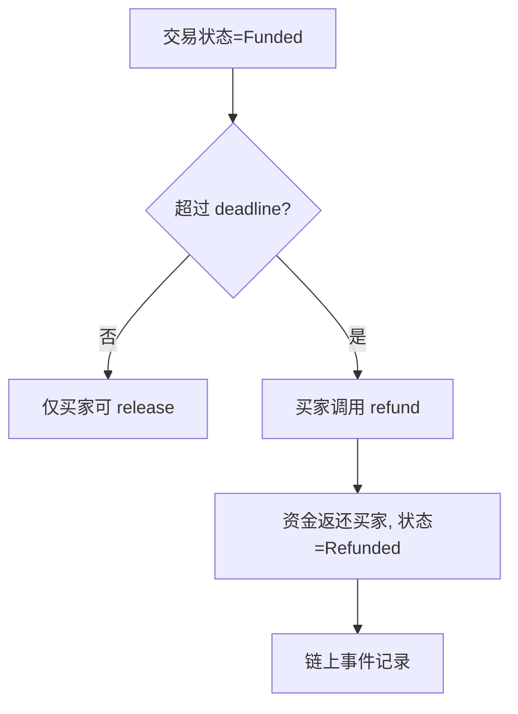

# TrustPay Lite — 产品需求文档（PRD）

> 版本：v1.0（MVP）　|　更新：2026-11-16　|　作者：AI 开发负责人（Tech Lead）

## 1. 产品概述

### 1.1 一句话定位

TrustPay Lite 是一个运行在 **Monad** 区块链上的去中心化交易担保支付 dApp，通过智能合约锁定买家资金，按预设条件完成资金释放或超时退款。

### 1.2 要解决的问题

陌生买卖双方在线上交易时存在双向信任缺失：

- **买家**担心先付款后卖家不履约 → 需要资金先锁定、确认后才释放。
- **卖家**担心交付后收不到款 → 需要资金在合约中可证明地存在，且买方可一键释放。
- **传统担保**依赖第三方（平台/担保人），增加信任成本、抽成与单点风险。

TrustPay Lite 用智能合约替代第三方：资金由代码托管，规则公开透明、不可篡改。

### 1.3 MVP 边界

**做**：创建交易、资金托管、买家释放、超时退款、链上事件与查询。
**不做**（明确排除）：AI 仲裁、争议解决系统、ERC-20 多币种、跨链、信用评分、DAO 治理、法币、商业化收费、复杂权限体系。

## 2. 用户角色分析

| 角色 | 定义 | 核心诉求 | 关键操作 |
|---|---|---|---|
| **Buyer（买家）** | 创建交易并支付 MON | 资金安全，确认交付后才付款 | 创建交易、释放资金、超时退款 |
| **Seller（卖家）** | 接收托管资金 | 确认资金真实存在、可及时到账 | 查看交易、等待释放 |

> 第一版无注册/认证体系，用户通过 EVM 钱包（如 MetaMask）访问。地址即身份。

## 3. 用户操作流程

### 3.1 正常交易流程（Happy Path）



### 3.2 超时退款流程



### 3.3 关键业务规则

1. 资金存入合约即锁定，买家和卖家**都不能**绕过合约直接提取托管资金。
2. 释放（release）**只有买家**可调用；退款（refund）**只有买家**可调用，且**必须在截止时间之后**。
3. 允许买家在截止时间后仍主动 release（视为放弃退款权利、完成交易）。
4. **release 与 refund 只能成功一个**：状态变为 Released 或 Refunded 后，另一操作永久失效。

## 4. 智能合约功能清单

| 函数 | 调用者 | 功能 | 前置条件 |
|---|---|---|---|
| `createEscrow(seller, deadline, description)` | 任何人（作为买家） | 创建托管交易并存入 `msg.value` | 卖家非零地址、金额 > 0、deadline 在未来 |
| `release(escrowId)` | 买家本人 | 释放资金给卖家 | 状态 = Funded、调用者为买家 |
| `refund(escrowId)` | 买家本人 | 超时退款给买家 | 状态 = Funded、调用者为买家、已超时 |
| `getEscrow(escrowId)` | 任何人 | 查询单笔交易 | — |
| `getDealCount()` | 任何人 | 查询交易总数 | — |

**事件**：`EscrowCreated`、`EscrowReleased`、`EscrowRefunded`。

## 5. 数据结构设计

```solidity
enum Status { Funded, Released, Refunded }

struct Escrow {
    uint256 id;           // 自增交易 ID
    address buyer;        // 买家（创建者）
    address seller;       // 卖家（收款方）
    uint256 amount;       // 托管金额（原生 MON，wei 单位）
    string  description;  // 交易描述
    uint256 deadline;     // 截止时间（Unix 时间戳，秒）
    Status  status;       // 当前状态
    uint256 createdAt;    // 创建时间（Unix 时间戳，秒）
}
```

> 存储：`mapping(uint256 => Escrow) public escrows;` + `uint256 public dealCount;`

## 6. 前后端接口设计

前端通过 **合约 ABI** 与钱包（Wagmi/Viem）交互，无自建后端：

| 前端动作 | 合约调用 | 参数 | 说明 |
|---|---|---|---|
| 创建交易 | `createEscrow` | seller, deadline, description | 附 `value` = 金额 |
| 释放资金 | `release` | escrowId | 需买家钱包签名 |
| 超时退款 | `refund` | escrowId | 需买家钱包签名 |
| 读交易列表 | `getDealCount` + `getEscrow(i)` | — | 遍历查询 |
| 监听事件 | 订阅 `EscrowCreated/Released/Refunded` | — | 实时刷新 |

## 7. 功能验收标准

- 创建交易后，合约余额增加对应 MON，状态为 `Funded`。
- 非买家调用 release/refund → 交易回滚。
- 买家 release → 卖家余额增加对应金额，状态 `Released`。
- 未超时调用 refund → 回滚；超时后买家 refund → 买家余额返还，状态 `Refunded`。
- release/refund 二选一，成功一次后另一操作回滚。
- 前端显示状态与链上一致。

## 8. 非功能要求

- **安全**：Checks-Effects-Interactions、防重入、零地址/零金额校验、权限全在合约侧。
- **可验证**：所有资金流转记录事件，区块浏览器可查。
- **提示**：项目为教育与黑客松原型，未专业审计，不承载真实商业资金。
