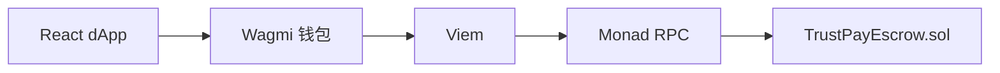

<div align="center">

# ⚡ TrustPay Lite

**A Simple On-chain Escrow Payment dApp on Monad**
基于 Monad 的去中心化交易担保支付应用

[](https://soliditylang.org/)
[](https://hardhat.org/)
[](https://react.dev/)
[](https://monad.xyz/)
[](./TEST_REPORT.md)
[](./README.md)

</div>

---

TrustPay Lite 用 **Solidity 智能合约** 在 Monad 区块链上实现交易资金托管、资金释放与超时退款，解决陌生买卖双方的信任问题——**用代码替代第三方担保，规则公开透明、不可篡改**。

> ⚠️ **免责声明**：本项目为教育与黑客松原型，**未经专业审计，不承载真实商业资金**。

---

## 🎯 解决了什么问题？

陌生双方在线交易时存在双向信任缺失：

| 角色 | 担忧 | TrustPay Lite 的解法 |
|---|---|---|
| 🛒 买家 | 怕先付款后卖家不履约 | 资金先锁进合约，确认交付后才释放 |
| 🏪 卖家 | 怕交付后收不到钱 | 资金真实锁定在链上，可查证，买家一键释放 |

## ✨ 核心特性

- 🔒 **资金托管**：创建交易时 MON 存入合约，双方都无法绕过合约直接提款
- ✅ **确认释放**：买家确认交付后调用 `release`，资金自动转给卖家
- ⏰ **超时退款**：超过截止时间买家可调用 `refund`，全额退回
- 🛡️ **安全保障**：ReentrancyGuard + Checks-Effects-Interactions，防重入攻击
- 📜 **全程可查**：每步操作记录链上事件，区块浏览器可验证

**状态机**：`Funded → Released` 或 `Funded → Refunded`（互斥，只能成功一个）

## 🏗️ 技术架构

| 模块 | 技术 |
|---|---|
| 智能合约 | Solidity 0.8.31（EVM 目标 osaka）|
| 合约开发环境 | Hardhat 3 + Ignition |
| 安全组件 | OpenZeppelin（ReentrancyGuard）|
| 前端 | React + TypeScript + Vite |
| 钱包交互 | Wagmi + Viem |
| 网络 | Monad Testnet（Chain ID 10143，原生币 MON）|



## 🚀 快速开始

```bash
# 合约
npm install
npm run compile     # 编译
npm test            # 16 项测试

# 前端
cd frontend
npm install
npm run dev         # http://localhost:5173
```

## 🧪 测试与验证

- ✅ 16/16 自动化测试通过（含权限、状态机、时间边界、余额一致性）
- ✅ 真实重入攻击测试：恶意合约无法重复提款
- ✅ 端到端两链路验收：正常释放 + 超时退款均成功

详细结果见 **[TEST_REPORT.md](./TEST_REPORT.md)** 与 **[SECURITY_REVIEW.md](./SECURITY_REVIEW.md)**。

## 🖼️ 演示

> 📸 *（截图占位：分别在「首页 Dashboard」「创建交易」「交易列表 + 详情」「区块浏览器交易记录」处截图，放入 `docs/screenshots/` 后取消下方注释即可展示）*
>
> <!--  -->
> <!--  -->

- 🎬 **60 秒英文介绍** / 3 分钟演示稿 / 答辩 FAQ → 见 **[DEMO_SCRIPT.md](./DEMO_SCRIPT.md)**
- 📚 **Web3 核心概念讲解**（结合本项目代码）→ 见 **[TEACHING_GUIDE.md](./TEACHING_GUIDE.md)**

## 📁 项目结构

```
trustpay-lite/
├── contracts/           # 智能合约（TrustPayEscrow.sol、ReentrancyAttack.sol）
├── test/                # 自动化测试（16 项）
├── ignition/modules/    # Hardhat Ignition 部署模块
├── scripts/             # 端到端演示脚本
├── frontend/src/        # React 前端（组件 / hooks / 配置）
└── *.md                 # 项目文档
```

## 📖 文档导航

| 文档 | 内容 |
|---|---|
| [PRD.md](./PRD.md) | 产品需求文档 |
| [ARCHITECTURE.md](./ARCHITECTURE.md) | 系统架构设计 |
| [SECURITY_REVIEW.md](./SECURITY_REVIEW.md) | 安全审查报告 |
| [TEST_REPORT.md](./TEST_REPORT.md) | 测试报告 |
| [DEMO_SCRIPT.md](./DEMO_SCRIPT.md) | 演示脚本与答辩 FAQ |
| [TEACHING_GUIDE.md](./TEACHING_GUIDE.md) | Web3 核心概念讲解 |
| [PROJECT_STATUS.md](./PROJECT_STATUS.md) | 项目状态追踪 |

## 🔗 Testnet 部署

```bash
# 1. 复制 .env.example 为 .env，填入测试钱包私钥（.env 已被 gitignore）
# 2. 到 https://testnet.monad.xyz 领取测试币
npx hardhat ignition deploy ignition/modules/TrustPayEscrow.ts --network monadTestnet
# 3. 把合约地址填入 frontend/.env 的 VITE_CONTRACT_ADDRESS
```

> 当前状态：**本地开发完成**。Testnet 部署与合约地址将在部署后补充。

---

<div align="center">

Built with ❤️ for learning Web3 & Monad Blitz

</div>
